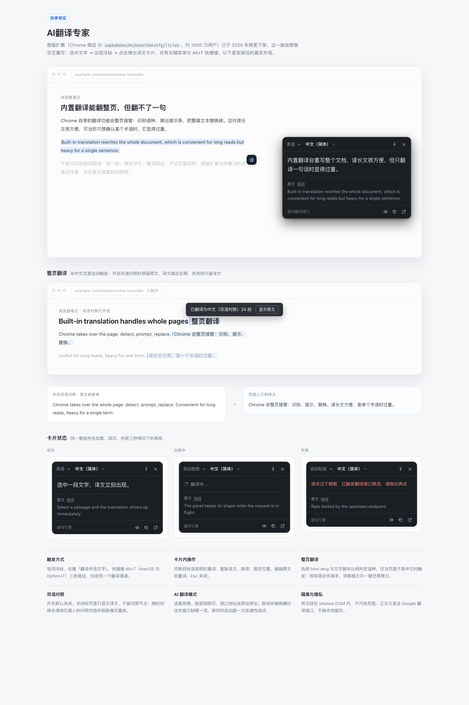

# AI翻译专家

Chrome 扩展（Manifest V3），主打划词与整页翻译。交互原型来自已下架的 Google 翻译扩展（"选中文字 → 浮标 → 译文卡片"），并在此基础上补上右键菜单、快捷键、**非中文页面自动整页翻译（可切换双语对照）**，以及**可接入自备大模型的 AI 翻译通道**。



---

## 一、原扩展的结局

| 项目 | 事实 |
| --- | --- |
| 商店 ID | `aapbdbdomjkkjkaonfhkkikfgjllcleb` |
| 用户量 | 约 3500 万 |
| 最后版本 | v2.0.16（2024-09-05） |
| 状态 | 已停止维护，从 Chrome 应用商店下架 |
| 功能收缩 | 自 v2.14 起，整页翻译移交 Chrome 内置翻译，扩展只保留划词与右键翻译 |

官方在支持论坛的回复是明确的：Google Translate 扩展已由团队停止支持，请改用 Chrome 内置翻译。本扩展保留原扩展不可替代的划词与右键路径；整页翻译则按实际使用习惯重新实现为可开关的自动能力（原版后期已交由浏览器接管，交互与触发条件都与内置翻译不同）。

## 二、能力清单

| 能力 | 实现方式 |
| --- | --- |
| 划词浮标 | 选中文字后，在选区末尾浮出 `译` 图标，点击即翻译 |
| 译文卡片 | 顶部显示语种流向与目标语言，正文为译文，下方折叠原文 |
| 卡片内操作 | 切换目标语言即时重译、复制、朗读、固定位置、编辑原文后重译、Esc 关闭 |
| 右键翻译 | 选中文字右键 →「翻译所选文字」 |
| 快捷键 | 默认 `Alt+T`（macOS 为 `Option+T`），可在 `chrome://extensions/shortcuts` 改 |
| 选中即翻译 | 可选开关，松开鼠标直接出译文 |
| 自动整页翻译 | 检测页面语言，非中文自动整页译为中文，顶部提示可一键还原 |
| 双语对照 | 开关式，默认关闭；开启后保留原文、译文插在右侧，关闭时不残留任何对照节点 |
| AI 翻译模式 | 开关式，默认关闭；选服务商 + 贴密钥即可接入自备大模型，配置完整后才生效 |
| 引擎互斥 | AI 与非 AI 二选一：开启任一侧，另一侧自动取反，弹窗与设置页状态共用一份存储 |
| Token 统计 | 累计输入 / 输出 / 总 token 与预估花费，标注估算次数，可一键重置 |
| 缓存策略 | 默认全局共享（跨站点复用同一文本译文）；可切换「仅当前站点」应对上下文敏感场景 |
| 双通道自动切换 | 能访问 Google 时用 Google 免费接口，否则用国内接口（腾讯交互翻译，免密钥）；Google 限流自动降级 |
| 网络环境检测 | 启动与打开弹窗时探测 Google 可达性，无代理环境自动落到国内接口并给出提示 |
| 手动整页翻译 | 弹窗里一键「翻译此页 / 显示原文」，中文页面也强制可用 |
| 排除站点 | 按域名屏蔽，命中后不弹浮标、不响应快捷键、不自动翻译 |
| 语言覆盖 | 40 种常用目标语言，源语言自动检测 |

### 与原版的设计差异

1. **不遮挡阅读**：卡片采用固定定位 + 智能避让（下方空间不足时翻到上方），不在页面里插入占位元素。
2. **样式隔离**：整个 UI 挂在 Shadow DOM 内，样式通过 `adoptedStyleSheets` 注入，既不受页面 CSS 污染，也不受页面 CSP 限制。
3. **通道可选**：原版只有一条 Google 直连通道，这里给了三条（见「网络说明」）。
4. **深色适配**：跟随系统 `prefers-color-scheme` 自动切换。

## 三、整页翻译怎么工作

开关在**弹窗**（自动翻译整页）和**设置页**（自动翻译整页）两处，默认**开启**。触发条件与处理链路：

1. **语言判定**：先读 `<html lang>`，再取页面正文最多 1400 字做脚本比例统计（中日韩、拉丁、西里尔、阿拉伯、泰文）。假名占比高判日语，韩文占比高判韩语，汉字占比超 35% 判中文；标签与实际文本冲突时**以文本为准**（防止误标站点把英文页当成中文而跳过）。
2. **触发条件**：判定为非中文 + 正文样本不少于 80 字 + 不在排除名单 + 不是设计模式页面。满足才自动开跑；手动「翻译此页」不受语言限制。
3. **节点收集**：`TreeWalker` 遍历文本节点，跳过 `script/style/code/pre/textarea/input/svg/iframe`、`contenteditable`、`[translate="no"]`、`.notranslate` 以及扩展自身的浮层。
4. **合批请求**：相同文本先去重（同一句只翻一次），再把 8 个节点 / 1400 字拼成一批，用 `%%1%% %%2%%` 前缀标记段序，一次请求翻完整批，随后按标记切回。请求数通常是节点数的 1/5～1/8，明显降低限流概率。
5. **失败兜底**：若译文里的标记丢失、顺序错乱或整批被限流，该批自动降级为逐条请求，保证覆盖率而不是整页失败。
6. **回写与还原**：只改文本节点的 `nodeValue`，保留原有首尾空白与所有标签结构；原文存在 `Map` 里，点顶部提示的「显示原文」即可逐字回滚。弹窗里也有「显示原文」。
7. **显示模式（双语对照开关）**：默认关闭。关闭时按上面的替换方式渲染；开启时不动原文，在每个文本节点后插入一个 `span[data-gt-bi]` 承载译文（浅蓝底 + 左侧细线），结构与原文并存。切换该开关会先移除已插入的对照节点、再按新模式重排，翻译结果命中缓存，代价很小；关闭后页面上不留任何对照痕迹。
8. **动态内容**：翻译完成后挂 `MutationObserver`，页面异步加载的新段落会在 700ms 内增量补翻（只增量，不重跑全页）。

翻译过程在页面顶部有实时进度（`正在翻译页面… 12/34`），完成后变成「已翻译为中文 · N 段 / 显示原文」，9 秒后自动收起。

**边界**：表单值、`placeholder`、图片 `alt` 与 `title` 属性不翻译；高度动态的 Web 应用（后台、编辑器）可能因文本变长导致排版变化，建议把这类站点加入排除名单。

## 四、AI 翻译模式

独立开关，默认关闭。开启后所有翻译（划词卡片与整页翻译）都走你配置的模型，Google 与国内接口同时停用。

**配置只有两步：选服务商、贴密钥。** 接口地址由预设带出，不需要知道什么是 endpoint。

| 预设服务商 | 预设模型 |
| --- | --- |
| OpenAI | gpt-4o-mini / gpt-4o / gpt-4.1-mini |
| DeepSeek 深度求索 | deepseek-chat / deepseek-reasoner |
| 阿里云百炼（通义千问） | qwen-plus / qwen-turbo / qwen-max / qwen-long |
| 智谱 GLM | glm-4-flash / glm-4-air / glm-4-plus |
| 月之暗面 Kimi | moonshot-v1-8k / moonshot-v1-32k |
| 硅基流动 SiliconFlow | Qwen2.5-7B / DeepSeek-V3 |
| 火山方舟（豆包） | doubao-pro-32k / doubao-lite-32k |
| 自定义（OpenAI 兼容） | 手填接口地址与模型 ID，其余服务商不显示该字段 |

- 模型下拉里选「其他」可手填模型 ID；选「自定义」时才会出现接口地址输入框（同样可只填到版本号）。
- 密钥旁边有「获取密钥」，直达对应厂商的控制台。
- 点「保存」会先申请该服务商域名的访问权限，落库后**自动跑一次连通性测试**并回显译文本。

校验与提示：

1. 缺项时开关仍可打开，但配置状态变为琥珀色「配置不完整」并逐项列出缺什么；此期间的翻译请求会直接被拦下并返回「AI 翻译尚未配置完整（服务商），缺少：…」，**不会静默回退免费通道**。
2. 保存与请求阶段分别给出：地址格式无效、未授予域名权限、鉴权失败（401/403，带上游原文）、地址不存在（404）、模型或参数不被接受（400）、频率限制（429）、网络不可达。
3. 提示词强制两项约束：保持 `%%N%%` 分段标记不变、保持换行与数字不变；AI 通道下整页批大小收紧到 4 节点 / 900 字，即使模型丢标记降级为逐条，代价也可控。

### 开关与互斥

AI 开关同时出现在弹窗（翻译引擎分组）与设置页，两处读写同一份 `storage.local`，任一界面改动另一界面即时同步。

互斥规则：同一时刻只有一个引擎生效。

- 开启 AI → 自动把「非 AI 翻译」置为关闭；关闭 AI → 自动把「非 AI 翻译」置为开启。
- 不允许两个都关：关掉「非 AI 翻译」会自动切到 AI；若 AI 还没配置完整，则拒绝关闭并保持非 AI，避免出现「没有任何可用通道」。
- AI 未配置完整时不允许开启，开关会回弹并提示缺哪几项、自动聚焦对应输入框（弹窗侧会引导跳转到 AI 配置）。

### Token 消耗统计

- 每次 AI 调用后累加 `usage.prompt_tokens / completion_tokens / total_tokens`；厂商未返回 `usage` 时按字符折算（拉丁 4 字符≈1 token、CJK 1.5 字符≈1 token），并单独标记「按字符估算」的次数。
- 花费按内置公开价目表（美元 / 1M token）估算；未收录单价的模型只统计 token，不计金额，界面会说明。
- 统计面板展示：总 token、输入、输出、预计花费，并注明「按公开单价估算，实际以厂商账单为准」，可重置。
- 统计只覆盖 AI 通道；免费 / 网关 / Cloud 通道不计入。

### 缓存与成本

- **默认全局共享**：缓存键为「通道 + 目标语言 + 文本指纹」，同一段文本在 A 站翻过，B 站直接命中，不重复消耗 token。
- 可在设置页把「缓存策略」切到**仅当前站点**：键里加入站点名，同一篇文章在不同站点各翻一次，适合术语或语境因站而异的场景。
- 上限 400 条、保留 7 天；键用 64 位 FNV-1a 指纹，长文本不会撑大存储。
- 内存与 `storage.session` 双层：Service Worker 空闲被回收后，下次唤醒会自动把上次会话的缓存捞回内存，**不会因为休眠就重翻一遍**；浏览器完全退出后清空（session 语义，不落盘）。
- 设置页「翻译服务 → 翻译缓存」显示条数与近似体积，可一键清除。

## 五、翻译服务模块（取数层）

设置页的「翻译服务（取数层）」解决的是**译文从哪里来**，与「AI 翻译模式」互斥生效：AI 开启时本模块整体停用。

### 两条非 AI 通道

| 通道 | 说明 | 需要密钥 | 适用网络 |
| --- | --- | --- | --- |
| Google 免费接口 | `translate.googleapis.com` 的公开接口，质量稳定 | 否 | 需要能访问 Google（代理 / VPN / 自建网关） |
| 国内接口 | 腾讯交互翻译 `transmart.qq.com`，实测约 200ms | 否 | 国内直连，无需代理 |

两条通道都**不需要填写任何密钥**，也不需要注册账号。

### 什么时候需要替换国内接口

默认的内置接口是腾讯网页端的公开接口：免配置、国内直连、实测约 200ms，但**没有 SLA，也不承诺长期可用**。只有下面两种情况才需要替换：

1. **内置接口不可用**：出现异常、被限流，或你所在网络访问不到 `transmart.qq.com`；
2. **你已有正式账号**：希望走官方计费通道，拿到配额承诺、账单与技术支持。

替换方式：设置页「翻译服务 → 国内接口来源」选择厂商并填入凭证，保存后自动跑一次连通性测试。**不配置时下拉保持「内置」即可，行为与之前完全一致。**

| 选项 | 需要填写 | 计费 |
| --- | --- | --- |
| 内置（腾讯交互翻译） | 无 | 免费（未公开接口） |
| 百度翻译开放平台 | APP ID、密钥 | 按字符计费（有免费额度） |
| 有道智云 | 应用 ID、应用密钥 | 按字符计费（有免费额度） |
| 腾讯云机器翻译 | SecretId、SecretKey、地域 | 按字符计费 |

签名实现均已通过单元测试校验：百度为 `MD5(appid+q+salt+key)`，有道为 `SHA256(appKey+截断输入+salt+curtime+appSecret)`（signType=v3），腾讯云为 TC3-HMAC-SHA256；测试里用 Node 的 `crypto` 独立复算并逐字节比对。**但这三家的真实账号未在本机联调过**，首次使用时请用「测试」按钮确认，若报鉴权错误优先核对凭证与地域。

### 自动切换规则

1. **未使用代理**：探测不到 Google（1.8 秒超时）→ 自动使用**国内接口**。
2. **使用代理**：能访问 Google → 自动使用 **Google 免费接口**。
3. **Google 触发限流（HTTP 429）**：自动降级到**国内接口**，并把 Google 打入 3 分钟冷却；冷却期内直接走国内接口，不再反复试探。
4. **Google 网络异常**（连不上、超时、5xx）：同样降级，并把网络状态标记为「不可访问 Google」，下次直接走国内接口。
5. **手动开启 AI 翻译**：两条非 AI 通道全部停用，所有请求走你配置的模型；关闭 AI 后按上面的规则恢复。

网络探测方式：请求 `translate.googleapis.com/generate_204`，**能拿到任何 HTTP 响应即视为可访问**（比读取系统代理设置更可靠，也能识别「有代理但代理已失效」）。探测结果缓存 3 分钟，并写入 `storage.session`，Service Worker 被回收后无需重新探测。

### 配置项

| 配置项 | 作用 |
| --- | --- |
| 非 AI 翻译开关 | 启用双通道取数路线，与 AI 翻译互斥 |
| 当前通道 | 只读徽标：显示实际生效的通道，并在下方说明切换原因 |
| 网络环境 | 显示「可访问 Google / 需代理」，可手动「重新检测」 |
| 国内接口来源 | 内置（默认）/ 百度 / 有道 / 腾讯云，选中官方 API 后展开凭证输入与测试 |
| 非 AI 接口优先级 | 自动（推荐）/ 优先 Google / 优先国内接口，供特殊网络环境手动锁定 |
| 测试当前通道 | 发送一句示例文本，验证当前通道可用并回显耗时 |
| 自定义网关 | **仅作用于 Google 接口**：把 `translate.googleapis.com` 换成自建反代根地址 |
| 缓存策略 | 全局共享（默认）或仅当前站点 |
| 翻译缓存 | 条数与近似体积，可一键清除 |

### 提示位置

- **弹窗**：翻译引擎分组下方一行状态，例如「未检测到 Google 直连 · 已用国内接口」「Google 免费接口限流 · 已切到国内接口」，切换原因一目了然。
- **设置页**：「当前通道」与「网络环境」两处同时给出结论与原因，并可一键重新检测。
- **划词卡片**：页脚会显示本次译文来自哪条通道（Google 翻译 / 国内翻译接口 / AI 翻译），避免出现「用国内接口却标着 Google」的错位。

## 六、安装

1. 获取源码：`git clone https://github.com/NicoShaoXY/ai-translate-expert.git`，或从 [Releases](https://github.com/NicoShaoXY/ai-translate-expert/releases/latest) 下载 `ai-translate-expert-v1.7.0.zip` 并解压。
2. 打开 `chrome://extensions/`，右上角开启「开发者模式」。
3. 点击「加载已解压的扩展程序」，选择本项目的 `src` 目录。
4. 在工具栏把图标固定出来，点图标可确认目标语言与整页翻译开关。

新装的扩展不会自动注入到已经打开的标签页，刷新一次即可。

## 七、网络说明（重要）

非 AI 通道由后台自动选择，正常情况**不需要任何配置**：

- 国内网络（无代理）：探测不到 Google，直接走国内接口，可用；
- 有代理 / VPN：探测到 Google，走 Google 免费接口，质量更稳；
- 代理失效或 Google 限流：自动降级国内接口，用户无感。

只有在两种情况下需要手动介入：

1. **想固定走某条通道**：设置页「非 AI 接口优先级」选「优先 Google」或「优先国内接口」。
2. **想用自建反代替换 Google 的访问入口**：填「自定义网关」，它只影响 Google 那条通道，国内接口不受影响。首次保存会请求该域名的访问权限（`optional_host_permissions`，按需申请）。

一个最小可用的 nginx 反代示例：

```nginx
server {
    listen 443 ssl;
    server_name translate.example.com;

    location / {
        proxy_pass https://translate.googleapis.com;
        proxy_set_header Host translate.googleapis.com;
        proxy_ssl_server_name on;
        proxy_set_header Accept-Encoding "";
    }
}
```

限流说明：Google 免费接口与国内接口都有频率限制。整页翻译会在短时间内发出数十个请求，Google 侧更容易触发 429；触发后本扩展会自动降级，页面顶部仍会提示失败段数（如果有）。国内接口的限流阈值更宽松，通常不会成为瓶颈。

## 八、目录结构

```
src/
├── manifest.json        扩展清单（MV3）
├── background.js        Service Worker：通道调度（Google/国内/AI）+ 网络探测 + 限流降级 + 三家官方 API 适配、缓存、菜单
├── content.js           内容脚本：选区读取、浮标、卡片交互、复制与朗读、提示条
├── page-translate.js    整页翻译引擎：语言检测、节点收集、合批、回写/双语插入、还原、增量
├── panel-style.js       卡片样式（CSS 字符串，供 shadow root 与预览页共用）
├── panel-template.js    卡片 DOM 骨架（静态字符串，文案一律 textContent 写入）
├── langs.js             语言表（三端共用）
├── popup.html/css/js    工具栏弹窗：目标语言、三个开关、当前页面状态与一键翻译
├── options.html/css/js  设置页：语言、交互（含双语开关）、排除站点、通道与 API Key、AI 模式配置
├── icons/               16/32/48/128 图标
└── demo/preview.html    效果预览（直接用浏览器打开，不依赖扩展环境）
```

技术要点：

- 内容脚本以 `all_frames` 注入，`chrome.scripting.executeScript` 作为兜底，覆盖安装前已打开的页面；
- 翻译请求统一走 Service Worker，内存 LRU 缓存 400 条 + `storage.session` 持久化（300 条 / 7 天），同一文本并发请求合并；
- 请求带 12 秒超时（`AbortController`），429 / 5xx 自动重试一次；
- 译文与原文一律用 `textContent` / `nodeValue` 写入，避免译文里的 HTML 被执行；
- 整页翻译的并发上限为 2 批，避免瞬时打满接口配额。

## 九、本地测试

```bash
npm i jsdom                      # 仅测试用
node test/background.test.js     # 通道调度、限流降级、百度/有道/腾讯云签名、缓存、AI 与用量（58 项）
node test/content.test.js        # jsdom 模拟划词 → 浮标 → 卡片渲染 → 切语言 → Esc（12 项）
node test/options.test.js        # 设置页：AI/非 AI 互斥、未配置拦截、网络状态、缓存策略、用量面板（20 项）
node test/page.test.js           # 语言检测、合批、兜底、还原、双语对照、AI 批次收紧、熔断（35 项）
```

测试不依赖真实网络：所有请求由桩函数返回，断言的是解析、状态流转与 DOM 结果。`page.test.js` 覆盖五种语言的判定、误标站点纠偏、合批切段、标记丢失后的逐条兜底、原文还原、双语对照的插入与清除、AI 通道批次收紧、重复触发幂等、排除站点与网络熔断；`options.test.js` 覆盖 AI 与非 AI 的双向互斥、未配置时开关回弹与缺失提示、缓存策略落库、用量面板渲染；`background.test.js` 覆盖 AI 未配置拦截（预设与自定义两种语义）、服务商预设端点、提示词约束、markdown 围栏剥离、401/404 映射、缓存按通道隔离与两种策略、Token 累计与估价、以及「模拟 Service Worker 重启后仍命中会话缓存」。

## 十、隐私

- 选中的文本与页面正文只发往所选翻译通道（Google 或你自建的网关），不做任何本地持久化；
- 不采集页面内容、不注入统计脚本、不请求与翻译无关的权限；
- API Key 与网关地址存在 `chrome.storage.local`，仅本机可读；
- 「排除站点」中的域名完全不会被读取或翻译。

## 十一、免责声明

本项目为个人复刻实现，与 Google 无关联，非官方产品。免费通道依赖 Google 网页端未公开的接口，其可用性由 Google 单方面决定，随时可能变更或失效。
